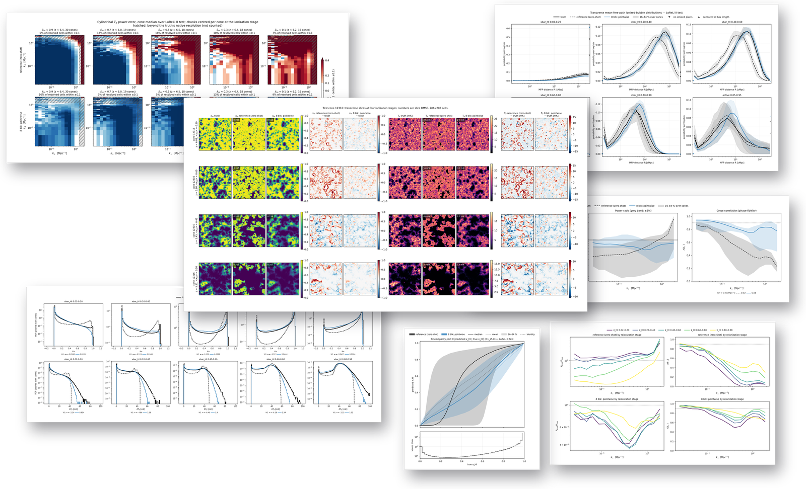

# 21cmEVAL

<p align="center">
  
</p>

End-to-end evaluation for 21cm field emulators. Point it at a model and a set
of lightcones: it runs inference once and reports every diagnostic used to
compare the models in [fno-21cm](https://github.com/thekaharis/fno-21cm) and
[rhizome](https://github.com/thekaharis/rhizome-neural-operator) — voxel accuracy,
scale-resolved and cylindrical power, bubble sizes, reionization history, the 21-cm
observable, EFT bias terms, ionization-front sharpness, and inference cost — and draws
the figures of both projects from the results.

The suite is model-agnostic by construction. A model is anything that maps a
sample to named 3-D arrays; adapters exist for plain Python functions,
PyTorch modules, external programs (read npz / write npz), and fno-21cm
checkpoints (rhizome models run through the Python adapter). Metrics are numpy-only, streaming accumulators, so a 200-cone
sweep costs one forward pass and constant memory.

```
eval21 demo --out demo          # synthetic data + toy model, ~10 s
eval21 selftest                 # analytic checks, no data needed
```

Full documentation is in [`docs/`](docs/index.md): architecture, the complete CLI reference,
data formats, every metric definition, adapters, the report schema, the figure catalogue and
the API reference.

## Install

```bash
python -m pip install -e .            # numpy + scipy
python -m pip install -e ".[all]"     # + torch, h5py, pytest
```

Python 3.10+.

## Quick start

```bash
# 1. Score a toy model on generated data
eval21 demo --out demo

# 2. Score an fno-21cm run on its own cube cache
eval21 run \
    --data /work/data/compressed/cubes_3d.h5 \
    --indices-json /work/fno-21cm/checkpoints/3d_xhi/fno/ckpt/run_metadata.json \
    --model fno=fno21cm:/work/fno-21cm/checkpoints/3d_xhi/fno/ckpt/best_model_state_dict.pt \
    --fno-root /work/fno-21cm \
    --expect-shape 140,140,256 \
    --limit 200 --out results/fno.xhi.h5

# 3. Compare several models in one pass over the data
eval21 run --data cubes/ \
    --model fno=fno21cm:.../best_model_state_dict.pt \
    --model ufno=fno21cm:.../best_model_state_dict.pt \
    --fno-root /work/fno-21cm \
    --metrics voxel,spectrum,bubble,history,front,efficiency \
    --out results/compare
```

Each model is written as one compressed HDF5 file, schema `eval21-run/1`:

```text
results/
├── fno.xhi.h5
└── ufno.xhi.h5
```

The file holds the metric results, per-sample arrays, dataset description and settings. Cubes
are **not** included; add `--cache results/fno.xhi.cache.h5` when map figures need them.

```python
from eval21.io import open_run
run = open_run("results/fno.xhi.h5")
run.result("voxel")["rmse"]
run.curves()["fno"]["spectrum_k"]
```

`--legacy-dir` still writes the old five-file directory (`results.json`, `summary.csv`,
`stages.csv`, `report.md`, `curves.npz`) for tools that have not moved yet.

## The data contract

A sample is one lightcone: named inputs, named targets, geometry.

```python
Sample(
    id="cone0000",
    inputs={"density": (Nx, Ny, Nz)},   # matter overdensity δ = ρ/ρ̄ − 1 (mean 0), as in 21cmFAST
    targets={"xhi": (Nx, Ny, Nz)},      # neutral fraction in [0, 1]
    meta=Meta(box_mpc=200.0, z_grid=(Nz,), omega_m=0.30966),
)
```

Arrays are `(Nx, Ny, Nz)`: `x`/`y` periodic transverse axes, `z` the
lightcone axis. Physics metrics use `density`; a sample without it is still
scored on every metric that needs only `xhi` (the others are listed under
`skipped` in the report). Inputs may be empty: a model conditioned on the
simulation parameters alone reads `sample.meta.params`.

A run scores one target field (`--target xhi` or `--target tb`; it sets the
data field, the adapter output and `Settings.target` together). Metrics that
are x_HI statistics (`history`, `bubble`, `morphology`, `front`, `observable`)
skip a T_b pass with a reason. Stages are always binned by the **true x_HI**
slice mean when the sample carries x_HI (a target or an input, `stage_field`),
so an x_HI and a T_b pass of the same cones use identical stage slices.

### Saved cubes (`.npz`)

Without a manifest, every `*.npz` in a directory is one sample; the target is
`xhi`, every other 3-D array is an input, and 1-D `z_grid` / `omega_m` set the
geometry.

With a manifest (paths relative to it):

```json
{
  "box_mpc": 200.0,
  "z_grid": [5.0, 5.1, "…", 25.0],
  "target": "xhi",
  "inputs": ["density"],
  "samples": [
    {"id": "cone0000", "path": "cubes/cone_0000.npz", "split": "test",
     "omega_m": 0.31, "params": {"F_ESC10": -1.2}}
  ]
}
```

### HDF5 cube caches

`--data cubes_3d.h5` auto-detects the fno-21cm layout: `x` `(N, C, Nx, Ny,
Nz)` + `y`, or `density` + `neutral_fraction` + `target_z` + `params`.
For a different layout construct `Hdf5Dataset` directly with explicit keys —
`eval21.data.hdf5` documents every argument.

The HDF5 loader indexes ids/parameters/geometry once and reads one cube per
iteration; it never materialises the cache. A 6600-cone `cubes_3d.h5` is about
265 GB, so opening it is cheap even on a login node, while the actual sweep
still wants a GPU (see below).

The fno-21cm adapter checks the checkpoint's recorded `spatial_shape` against
every sample and refuses a mismatch. Scoring a 256-slice model against a
512-slice envelope cache fails with "checkpoint expects spatial shape ... but
sample has ..." instead of producing a clean-looking 0.49 RMSE.

Older 3-D checkpoints predate `input_features.spatial_shape`; for those the
adapter warns that the geometry is unverified and the report records
`geometry_check: unverified`. Pass `--expect-shape NX,NY,NZ` (or `--expect-nz
N`) to enforce it explicitly. The cluster's `fno_fno` run is one of these:
without the flag the 512-slice cache is still accepted, with a warning. The
metadata does not record which simulation family a cache came from, so two
caches with identical shape cannot be distinguished automatically. If
`run_metadata.json` records `dataset.cache_file`, `cache_rows` or
`cache_shape`, the CLI enforces it before inference; a recorded `cache_sha256`
is verified by hashing the cache (slow for a 265 GB file). Recording
`cache_file` at training time makes the binding complete.

An HDF5 cache does not declare train/val/test splits, so `--split test` is
rejected instead of scoring every row. Use `--indices 0-199` for explicit row
numbers, or `--indices-json path/to/run_metadata.json` to reuse the split the
checkpoint was trained with. The latter prefers `split.test_cone_ids` and maps
them through the cache's `cone_id`, falling back to `test_indices` only when
the file has no ids; a recorded cone that is missing from the cache is an
error, not a silent omission.

### eval21 cube caches (`eval21 build`)

`eval21 build` turns a folder of simulations into one HDF5 cube cache that the
library reads natively (`--data cache.h5` detects it by its `format` attribute):

```bash
# 21cmFAST lightcones on fno-21cm's 512-plane envelope grid (identical to cubes_3d_envelope512.h5)
eval21 build /work/data/data --out fast.h5 --format 21cmfast --fields density,xhi,tb \
    --z-grid /work/data/compressed/cubes_3d_envelope512.h5:target_z --splits train=0.8,val=0.1,test=0.1

# LoReLi II five-field cones, native grid (128², 1536 planes uniform in z = 5–15), parameters from the id
eval21 build /work/data/loreli_lc128 --out loreli.h5 --format loreli --workers 4

# any folder of per-sample npz files (eval21's own cube format); every 3-D array becomes a field
eval21 build cubes/ --out cubes.h5 --format npz

# large sets: a Slurm array writes shards, one call joins them
eval21 build sims/ --out big.h5 --shard $SLURM_ARRAY_TASK_ID --num-shards 32
eval21 build --out big.h5 --merge --num-shards 32 --remove-shards
```

| option | meaning |
|---|---|
| `--format` | `21cmfast`, `loreli`, `npz`, `python:my_source.py:Class` (any class with `items()` and `read(item, fields)`, see `eval21.build.sources`), or `auto` |
| `--fields` | canonical names `density` (overdensity δ), `xhi`, `tb` [mK]; other names pass through (21cmFAST lightcone keys, LoReLi `xa`, `tpHI`) |
| `--targets` | fields stored as targets (default `xhi,tb`); the rest are inputs. Any field can still be a run's `--target` |
| `--z-grid` | `native`, `uniform:ZMIN,ZMAX,N`, `comoving:ZMIN,ZMAX[,N]` (without N: cubic cells), or a file (`.npy`, `.txt`, `FILE.h5:key`); linear per-pixel interpolation like fno-21cm's `build_cubes` |
| `--transverse N` | resample the transverse plane to N cells on the same box |
| `--splits` / `--split-file` | `test`, seeded fractions, or a JSON map / `run_metadata.json` (`<split>_cone_ids`) |
| `--dtype float16`, `--compress gzip\|lzf`, `--workers N`, `--limit`, `--ids` | size, speed, subsets |

The cache stores `fields/<name>` `(N, Nx, Ny, Nz)`, the shared `z_grid`, a per-sample
`valid` plane mask, ids, splits, Ω_m and parameters (`params/names`, `params/values`),
plus provenance (`source`, `command`, `created`, `eval21_version`, `skipped`). Planes a
simulation does not cover (outside its redshift range, LoReLi's empty or corrupt
low-z tails) are marked invalid. A run over samples with invalid planes stops and
names the widest common window; `eval21 run --z-range 8,12` evaluates that window
and drops the samples that do not cover it (this is how the LoReLi cones split into
redshift groups).

## Model adapters

| spec | meaning |
|---|---|
| `python:model.py[:predict]` | file defining `predict(sample) -> dict` |
| `torch:model.py[:build[:ckpt]]` | file defining `build()` returning an `nn.Module` |
| `command:"python infer.py {input} {output}"` | any program: read npz, write npz |
| `fno21cm:path/best_model_state_dict.pt` | fno-21cm run, uses its `run_metadata.json` |
| `synthetic:1.5` | built-in smoothed-threshold toy model |
| `toygen:1.5` | built-in toy *generative* model: a fresh random field per draw, no inputs |

The Python adapter is the whole contract:

```python
# my_model.py
import torch

_model = torch.jit.load("model.pt")

def predict(sample):
    x = torch.from_numpy(sample.inputs["density"])[None, None].float()
    with torch.no_grad():
        return {"xhi": _model(x)[0, 0].numpy()}

def describe():
    return {"framework": "torchscript", "parameters": 1_234_567}
```

`describe()` is optional and feeds the efficiency report. For the fno-21cm
adapter the architecture, input channels and parameter normalization all come
from the checkpoint's own `run_metadata.json` — nothing is duplicated, so
legacy, local-operator, waveform and contrast-wrapped runs load through the
repository's canonical loader.

An external program gets one npz per sample containing the input arrays and
a `meta` JSON string (targets are deliberately withheld), and must write an
npz with one array per target name. That is the escape hatch for Julia, C++
or a cluster job.

## Stochastic and generative models

`--draws N` asks every model for N predictions per sample. The adapter supplies them as
`predict(sample, draw=i)` (seed with `i` for reproducible runs), `predict_draws(sample, n)`
returning `{target: (n, Nx, Ny, Nz)}`, or a `(n, Nx, Ny, Nz)` target from `predict`. The
standard metrics then score one realisation (`--score-draw first`, the default) or the
ensemble mean (`--score-draw mean`), and the `ensemble` metric scores the whole ensemble:

* **voxel calibration** — fair CRPS, spread/skill ratio (1 = calibrated, also per stage),
  rank histogram of the truth among the draws (ties broken at random, needed for x_HI
  saturated at 0/1) with its χ², and rank-based coverage next to its exact nominal value;
* **summary-statistic calibration** — for x̄(z) at 16 LOS positions, the history
  z(x_HI = 0.25/0.5/0.75) and Δz, and Δ²(k) at `ensemble_k` per stage, the truth is
  located among the draws: randomised PIT histograms (uniform when calibrated), KS
  distance, coverage, mean z²;
* **cosmic variance** — when several samples share identical parameters, the draw spread
  is compared with the spread of their truths (≈ 1 is right; ≪ 1 is mode collapse).

`--mode generative` is for models whose fields need not align with the truth voxel by
voxel (a generator conditioned on parameters only). It skips the pointwise metrics
(`voxel`, `edge`, `parity`, `symmetry`) with a reason and removes the pointwise keys of
the others (coherence r(k), IoU, front-band RMSE, voxel calibration; listed under
`_generative_dropped`), keeping everything that compares distributions: power ratios,
bubble-size PDFs, histories, PDFs, morphology counts, EFT and the summary-statistic PITs.

```bash
eval21 run --data cubes.h5 --model gen=python:my_generator.py --draws 16 --mode generative \
    --out results/gen --cache results/gen/xhi.cache.h5
```

## Metrics

Every definition, result key and setting is documented in [`docs/metrics.md`](docs/metrics.md).

Stage-resolved metrics bin LOS slices by the **truth** slice mean x_HI, so
truth and prediction are always paired. `active` is the last row: slices with
`0.05 <= xbar_HI <= 0.95`.

| metric | reports |
|---|---|
| `voxel` | RMSE, MSE, MAE, bias, R², Pearson r, R² per sample (mean/p16/p84), forward-difference gradient RMSE, per-cube global-history MAE, global high-k power ratio/coherence |
| `edge` | transverse edge vs interior RMSE, active-window RMSE, global-history RMSE |
| `spectrum` | transverse P(k) ratio, coherence r(k), Δ²(k), k where r drops below 0.9, stage-resolved `HighKPowerRatio` kernel (`highk_logmse`) |
| `bubble` | mean-free-path bubble-size PDFs, restricted Wasserstein-1, Jensen-Shannon, size bias, censored fraction |
| `morphology` | 3-D ionized-region count, mean and volume-weighted radius, largest-bubble fraction, IoU at the fixed threshold and at the true ionized cell count |
| `history` | τ_e, z(x_HI = 0.25/0.5/0.75), Δz, errors in Planck 2018 σ |
| `observable` | x_HI and dT_b PDFs (W1), partially ionized fraction, dT_b variance/skewness, Δ²₂₁(k), power bias in units of single-slice sample variance |
| `dtb` | the model's own dT_b field: stage-resolved PDFs (W1), Δ²₂₁(k) ratio, power bias in single-slice σ; needs `--target tb` plus a true `xhi` input |
| `eft` | transfer T(k), stochasticity P_ε(k), r_uδ, fits b₁ + b_k²k² and P_ε,0 + P_ε,2k² |
| `front` | RMSE and gradient RMS vs signed distance to the true front, band RMSE, 10–90 front width |
| `front3d` | RMSE and gradient RMS vs 3-D signed distance to the true front (approximate LOS), band L2/H1, 10–90 front width |
| `parity` | conditional bias E[pred\|true] − true per truth bin, per-bin spread and RMSE, partial-range RMSE |
| `radial` | isotropic 3-D P(k) ratio and coherence (cross-check; non-periodic LOS) |
| `anisotropy` | cylindrical (k_perp, k_par) power ratio and coherence at z = 7/9/11 |
| `cylindrical` | full cylindrical (k_perp, k_par) power ratio and coherence maps per sample, LOS chunks at ionization stages (default x̄_HI 0.9/0.7/0.5/0.3/0.1) or fixed z, share of resolved cells within ±0.1, native-resolution limits; drawn by `eval21 plot cyl` |
| `gallery` | not a score: truth/prediction slices at x̄_HI 0.8/0.6/0.4/0.2 for a few samples, for `eval21 plot gallery` |
| `survey` | not a score: partial fractions, transverse/LOS total variation, band width per TV, voxel histogram of truth and prediction |
| `efficiency` | parameters, ms per lightcone (median/p16/p84), samples/s, slices/s, peak memory |
| `ensemble` | with `--draws N`: CRPS, spread/skill, rank histogram and coverage (voxels), PIT calibration of x̄(z), history and Δ²(k) per stage, cosmic-variance comparison |
| `symmetry` | RMS change under a transverse x↔y swap |

### Definitions worth stating

* **R²** uses the constant-mean predictor as reference. x_HI is bimodal, so
  this reference is poor and R² is flattering — a relative score, not an
  accuracy.
* **Spectra** are 2-D transverse spectra of individual slices, in Mpc². The
  LOS axis mixes geometry with evolution and the 256-cell grid discards most
  LOS structure, so a 3-D transform would not be interpretable. `k` therefore
  corresponds to 3-D wavenumbers of roughly 1–2 k_perp.
* **τ_e** integrates a global history with helium single ionization and He II
  → He III at z = 3; histories are clipped to [0, 1] so emulator overshoot
  cannot produce unphysical electron densities. Errors are quoted in units of
  the Planck 2018 σ (τ: 0.0073, z_re: 0.73).
* **dT_b** is the saturated-spin-temperature, no-RSD limit,
  `27 x_HI (1+δ) (Ω_b h²/0.023) sqrt(0.15/(Ω_m h²) (1+z)/10)` mK, with the
  *same* density for truth and prediction. It is not the 21cmFAST
  `brightness_temp` field (no T_S, no velocities); differences isolate the
  x_HI error.
* **Bubble sizes** are ionized-area-weighted mean free paths to the first
  neutral cell through periodic transverse slices, with censored rays folded
  in at `max_distance_mpc`. A blurry model over-produces small bubbles.
* **Power-bias significance** is `(P_pred − P_truth) / (P_truth sqrt(2/N_modes))`:
  the emulator bias in units of the Gaussian sample variance of one slice.
  `1/significance²` is how many independent slices an observer must average
  before the bias equals their error.
* **EFT** coefficients are fit per stage and compared cone by cone. A
  conditional-mean emulator usually reproduces T(k) but under-predicts P_ε.

## Figures

The full catalogue — every figure with its group, inputs, output files and options — is in
[`docs/visualization.md`](docs/visualization.md).

`eval21 plot` (needs `matplotlib`, `pip install -e ".[viz]"`) draws figures from run files or
legacy result directories. A directory is searched recursively for `results.json` and
`eval21-run/1` `*.h5` files, so a tree of runs (`<model>/<group>/<target>/`) can be passed whole. Runs of the same target on different data are
pooled as groups (e.g. redshift windows with one manifest each); a model must exist in every
group. An x_HI and a T_b run of the same samples combine in the gallery.

```bash
eval21 plot list                                   # every figure, its group and what it needs
eval21 plot all --run results/ --out figs/ [--models ref,tuned] [--style style.json] [--title "LoReLi II test"]
eval21 plot spectra maps --run results/ --out figs/ --opt vmax=0.3      # groups or single figures
```

Every figure is a function registered with `@figure(name, group=..., needs=...)` in
`eval21/visualization/` (a new figure is one decorated function). Figures marked *store* draw cube slices
and need cubes from `eval21 run --cache PATH` (or the legacy `--save-predictions DIR`; x_HI and
T_b runs may share a cache/store; `plot` finds `*.cache.h5` / `predictions/` next to the runs or
takes `--store`); without
it they are skipped with that reason, as is any figure whose metric was not run. All figures are
written as PNG and PDF. The fno-21cm and rhizome evaluation figures are ported with their
original layout, colour maps and limits; figures of model internals (spectral weights,
waveforms, gate mechanisms, training curves) are not part of an evaluation library.

| group | figure | needs | content |
|---|---|---|---|
| bubbles | `bubble_size_distribution` | results | MFP bubble-size PDF per stage, truth vs models with 16–84 % bands |
| bubbles | `bubble_size_summary` | results | per-stage restricted Wasserstein distance and mean-MFP bias bars |
| diagnostics | `parity_overlay` | results | binned parity plot E[pred x_HI | true x_HI] with 16–84 % band and bin occupancy |
| diagnostics | `boundary_band_overlay` | results | RMSE, mean x_HI (front width) and gradient error vs distance to the true front |
| ensemble | `ensemble_calibration` | results | rank histogram, PIT histograms, coverage vs nominal, spread/skill per stage |
| ensemble | `ensemble_draws` | store | truth, ensemble mean/std and draws at the gallery stages, per stored sample |
| maps | `gallery` | results | per-sample gallery: stages × (x_HI | T_b) truth / models / residuals |
| maps | `scatter_3d` | store | voxel hexbin of truth vs prediction per sample, one panel per model, R² / RMSE |
| maps | `multifield_los` | store | line-of-sight (x, z) planes at several y, cropped to the active band (`--opt full_z=1`) |
| physical | `physical_history` | results | history error band, τ / Planck histogram, midpoint and duration |
| physical | `physical_pdfs` | results | stage-resolved PDFs of x_HI and dT_b with W1 |
| physical | `physical_21cm` | results | 21-cm power, Δ² vs x_HI, dT_b moments, power-bias significance |
| physical | `physical_eft` | results | EFT transfer, stochasticity, correlation and per-cone bias fits |
| physical | `physical_3d` | store | per-sample page: global field vs z, 3-D power, cross-correlation |
| physical | `rmse_r2` | results | RMSE / R² per x_HI stage and overall (bars) |
| physical | `params_vs_accuracy` | results | model size (parameters) vs R² and vs RMSE with Pareto front |
| physical | `inference_speed` | results | throughput vs RMSE and parameters vs throughput |
| physical | `truth_sharpness_survey` | store | truth x_HI survey: voxel population, partial fraction, front width, TV vs slice x_HI |
| spectra | `cyl` | results | cylindrical P_pred/P_true − 1 maps (white dead band), rows = models |
| spectra | `ps_overlay` | results | active-stage Δ²(k), P_pred/P_true and r(k) per model |
| spectra | `ps_cyl_r` | results | coherence r(k_perp, k_par), rows = models |
| spectra | `cyl_anisotropy_decomposition` | results | cylindrical error split into k_par / k_perp marginals + advantage map |
| spectra | `ps_coherence_highk` | results | coherence r(k) vs small-scale power fidelity, with the placement/amount plane |

The two map/spectrum figures with the most files:

| kind | files | content |
|---|---|---|
| `cyl` | `cyl_error_<target>` | P_pred/P_true − 1 over (k_perp, k_par) on log axes, white within ±`cyl_dead_band`, rows = models, columns = stages (or z); median over samples; hatched beyond the truth's native resolution, not counted |
| `gallery` | `gallery/cone_<id>` | per stage: x_HI truth/models/model − truth (viridis, RdBu), then T_b (magma), slice RMSE per panel |

`--style` is a JSON file `{"model": {"label": "...", "color": "...", "ls": "--"}}`; by default the
first model is drawn dark grey dashed (the baseline) and the others in distinct colours.

Layout conventions, so long model labels stay readable and figures stay comparable:

- **One model key per figure**, above the panels and outside the axes (`visualization.common.shared_legend`):
  truth, then each model with its line sample, then figure-wide style keys (bands, markers,
  reference lines). Panels carry no model legends.
- **Per-panel statistics** (W1, |Δτ|, front widths, k(r < 0.9), …) sit in one line under the
  panel's x label as `label ── value  - - value`, drawn in each model's colour and line style
  (`visualization.common.pane_values`).
- **Image grids** (maps, slices, cyl maps) name models in wrapped panel titles or row labels.
- **Cylindrical (k⊥, k∥) maps are square.**
- Scatter figures name their points through the shared key; `--opt point_labels=1` also writes
  the name next to each point.

Stage chunks (`cyl_stages`) compare like with like across data sets that reionize at different
redshifts; fixed-z chunks (`cyl_z_centers`) can be dominated by fully neutral or fully ionized
volumes. When the truth was interpolated from a coarser native grid, declare it
(`cyl_native_cell_mpc`, `cyl_native_los_dz` or `cyl_native_los_mpc`) so unresolved wavenumbers are
excluded. The stage chunks need the true x_HI: an `xhi` target, or an `xhi` input in a T_b pass.

## Configuration

Everything on the command line can live in a TOML file:

```toml
[run]
data = "/work/data/compressed/cubes_3d.h5"
out = "results/fno"
split = "test"
limit = 200
target = "xhi"
density = "density"
fno_root = "/work/fno-21cm"

[models]
fno = "fno21cm:/work/fno-21cm/checkpoints/3d_xhi/fno/ckpt/best_model_state_dict.pt"

[settings]
box_mpc = 200.0
stage_edges = [0.02, 0.2, 0.4, 0.6, 0.8, 0.98]
rays_per_slice = 256
slices_per_stage = 6

[metrics]
enabled = ["voxel", "spectrum", "bubble", "history", "front"]

[metric_options.spectrum]
n_k_bins = 20
```

CLI flags override the file. `--set key=value` overrides one setting.
`eval21 list-metrics` prints the registry.

### Adding a metric

```python
from eval21.registry import register
from eval21.metrics.base import Metric

@register("mystat")
class MyStat(Metric):
    needs = ("density",)          # optional input fields

    def __init__(self, settings, options=None):
        super().__init__(settings, options)
        self.total = 0.0

    def update(self, sample, prediction, aux=None, runtime=None):
        truth = self.target(sample)
        pred = self.prediction(prediction)
        self.total += float(((pred - truth) ** 2).mean())

    def result(self):
        return {"mean_mse": self.total / max(1, len(self.__dict__))}
```

Import the module before the run (a small wrapper script that imports it and
calls `eval21.cli.main`) and pass `--metrics mystat`.

## Design

```
src/eval21/
├── physics.py        # cosmology, spectra, MFP rays, front widths (numpy)
├── spec.py           # Sample / Meta contract
├── settings.py       # one frozen dataclass for the whole suite
├── registry.py       # metric plugins by name
├── metrics/          # one module per family, all streaming accumulators
├── adapters/         # python, torch, command, fno21cm, synthetic
├── data/             # npz + manifest, hdf5 cube cache, eval21 cube cache, synthetic
├── build/            # simulation folder -> eval21 cube cache (HDF5)
├── store.py          # prediction cubes for map figures
├── visualization/    # figure registry and every figure (matplotlib, optional)
├── runner.py         # one pass per model, skip reporting, timing
├── report.py         # JSON / CSV / Markdown / NPZ
├── cli.py
└── selftest.py       # analytic checks with known answers
docs/                 # architecture, CLI, data, metrics, adapters, reports, figures, API
```

* **One pass.** Every enabled metric updates from the same prediction.
* **Constant memory.** Accumulators are sums, histograms and per-cone scalars;
  no metric stores a cube after `update` returns.
* **Fast ray tracing.** Bubble sizes use a vectorised DDA that advances all
  rays together: 256 rays on a 140² slice take about a millisecond, so the
  full stage-resolved bubble diagnostic costs ~0.06 s per cone.
* **Cost on real data.** On 16 CPU cores a 140²×256 forward pass is 30–60 s
  and the full 14-metric pass is ≈4–5 min per cone; voxel+history+parity is
  ≈55 s per cone. Use a GPU for production sweeps.
* **Fail loudly.** Shape mismatches, missing channels and unknown metrics
  raise; a metric that cannot run is listed under `skipped` with the reason.
* **Numpy core.** `import eval21` does not import torch. Torch appears only
  inside the torch and fno-21cm adapters.


## Tests

```bash
python -m pytest          # ~140 tests, a few minutes (figure tests build a small synthetic fixture), no data and no GPU
eval21 selftest         # same analytic checks, no pytest

# Optional: pin the physics primitives to the fno-21cm reference code
FNO21CM_ROOT=/work/fno-21cm python -m pytest tests/test_reference_agreement.py
```

`tests/test_reference_agreement.py` asserts bit-level agreement with
`fno-21cm` for tau_e, crossing redshifts, dT_b, binned power, the WLS fit and
mean-free-path ray tracing (same RNG stream and seeds). It skips without
`FNO21CM_ROOT`.

The tests pin the definitions that are easy to get subtly wrong: RMSE and R²
against closed forms, coherence = 1 for identical fields, τ_e ordering, a ray
tracer against a half-plane, a sphere's effective radius, front width of a
known sigmoid, and a strict-JSON report.
